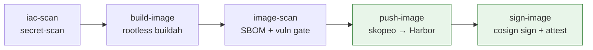

# platformSec: A Secure Container Platform Lab

A home lab that builds, on a single NixOS workstation, a small but realistic **secure platform for running containers**, and proves with tests that its security controls actually work.

Everything is created from code. Terraform and Ansible build a three-node Kubernetes cluster and a separate registry VM. A GitLab pipeline builds an application image, scans it, records what is inside it, signs it, and stores it in a private Harbor registry.

> **Status:** Parts 1 and 2 are complete and tested. Parts 3+ are planned (see the [Roadmap](#roadmap)).

---

## Table of contents

- [Goals](#goals)
- [Architecture](#architecture)
- [Roadmap](#roadmap)
- [Versions](#versions)
- [Repository layout](#repository-layout)
- [Prerequisites](#prerequisites)
- [Part 1: Foundations and infrastructure](#part-1-foundations-and-infrastructure)
- [Part 2: Registry and pipeline](#part-2-registry-and-pipeline)
- [Security design decisions](#security-design-decisions)
- [Lab-only shortcuts](#lab-only-shortcuts)
- [Operations cheat sheet](#operations-cheat-sheet)
- [Troubleshooting](#troubleshooting)

---

## Goals

By the end of the lab, the platform will:

1. Be fully reproducible: destroy and rebuild everything with one command.
2. Build, scan, create an SBOM for, sign, and publish images through a CI pipeline.
3. Refuse to run any image that was not signed by that pipeline.
4. Forbid risky pod settings and block unwanted network traffic.
5. Be managed from Git (GitOps) with Argo CD.
6. Keep secrets in OpenBao and hand them to apps as short-lived files.
7. Raise alerts when something important fails.
8. Take backups and prove they can be restored.

## Architecture

```
                  ┌──────────────────────────── NixOS host (libvirt/KVM) ───────────────────────────┐
                  │                                                                                  │
 GitLab.com ◄────►│  GitLab Runner (docker executor)                                                 │
 (pipeline)       │                                                                                  │
                  │   virbr-lab  192.168.150.0/24  (NAT)                                             │
                  │   ┌──────────────┐  ┌──────────────┐  ┌──────────────┐  ┌────────────────────┐  │
                  │   │ cp1 .10      │  │ w1 .11       │  │ w2 .12       │  │ registry .20       │  │
                  │   │ control plane│  │ worker       │  │ worker       │  │ Harbor + Trivy     │  │
                  │   │ 2 vCPU/4 GiB │  │ 2 vCPU/6 GiB │  │ 2 vCPU/6 GiB │  │ 2 vCPU/4 GiB       │  │
                  │   └──────────────┘  └──────────────┘  └──────────────┘  └────────────────────┘  │
                  │        Kubernetes 1.36 (kubeadm) + Calico CNI            harbor.lab.test (TLS)   │
                  └──────────────────────────────────────────────────────────────────────────────────┘
```

**Pipeline flow**



Push and sign run **only on `main`**. Merge requests stop after the scan gates.

| Node     | Role          | IP               | Resources         |
| -------- | ------------- | ---------------- | ----------------- |
| cp1      | Control plane | `192.168.150.10` | 2 vCPU, 4 GiB, 40 GiB |
| w1       | Worker        | `192.168.150.11` | 2 vCPU, 6 GiB, 40 GiB |
| w2       | Worker        | `192.168.150.12` | 2 vCPU, 6 GiB, 40 GiB |
| registry | Harbor        | `192.168.150.20` | 2 vCPU, 4 GiB, 80 GiB |

## Roadmap

- [x] **Part 1:** NixOS host, pinned dev shell, Terraform VMs, Ansible hardening, kubeadm + Calico
- [x] **Part 2:** Harbor with private-CA TLS, Ansible Vault, GitLab pipeline (scan → build → SBOM → push → sign)
- [ ] **Part 3:** Admission control: only images signed by the pipeline may run
- [ ] **Part 4:** Pod security restrictions and Calico `NetworkPolicy`
- [ ] **Part 5:** GitOps with Argo CD
- [ ] **Part 6:** Secrets with OpenBao, delivered as short-lived files
- [ ] **Part 7:** Monitoring and alerting
- [ ] **Part 8:** Backup and restore, tested for real

## Versions

| Tool           | Version     |
| -------------- | ----------- |
| Terraform      | 1.15.3      |
| libvirt provider | 0.9.9 (exact pin) |
| Ansible core   | 2.21        |
| Kubernetes     | 1.36.4      |
| Calico         | v3.33.0     |
| Harbor         | v2.15.4     |
| Trivy (CI)     | 0.76.0      |
| Cosign (CI)    | v3.1.2      |
| Helm           | 3.20.2      |
| Guest OS       | Ubuntu 24.04 (noble) cloud image |

Run `make versions` to print the versions installed in your shell.

## Repository layout

```
.
├── flake.nix / flake.lock      # pinned dev shell (all tools)
├── Makefile                    # up / down / rebuild / scan / versions
├── .gitlab-ci.yml              # the pipeline
├── cosign.config               # cosign signing config (no tlog / TSA)
├── app/                        # the Python application + Dockerfile
├── terraform/                  # VMs, network, storage pool, cloud-init templates
├── ansible/
│   ├── ansible.cfg
│   ├── inventory/              # generated.json (from Terraform) + group_vars
│   ├── playbooks/site.yml
│   └── roles/                  # base, ssh_hardening, lab_ca, containerd,
│                               # kubernetes_common, control_plane, worker, registry
├── pki/                        # PUBLIC certs only: lab-ca.crt, cosign.pub
└── scripts/                    # vendor-calico, make-lab-pki, fetch-harbor, versions
```

## Prerequisites

- A NixOS host with virtualization (KVM) enabled
- ~16 GiB free RAM, ~200 GiB free disk
- A GitLab project and a project runner on the host
- A password manager for the Ansible Vault password and the cosign key

### NixOS host configuration

```nix
{ pkgs, ... }:
{
  virtualisation.libvirtd.enable = true;

  # Replace YOURUSER. libvirtd = manage VMs without root, kvm = /dev/kvm access.
  users.users.YOURUSER.extraGroups = [ "libvirtd" "kvm" ];

  # The lab network's bridge (defined in Terraform as virbr-lab).
  networking.firewall.trustedInterfaces = [ "virbr-lab" ];

  nix.settings.experimental-features = [ "nix-command" "flakes" ];

  # Needed for the GitLab runner's docker executor.
  virtualisation.docker.enable = true;
}
```

---

## Part 1: Foundations and infrastructure

### 1.1 Dev shell

All tools come from a Nix flake pinned to `nixos-26.05` (terraform, ansible, kubectl, helm, cosign, trivy, jq, yq, xorriso, libvirt, …).

```bash
git add flake.nix && nix flake lock && git add flake.lock
nix develop --profile .devshell     # build once and pin as a GC root
printf '.devshell*\n' >> .gitignore
```

Optional alias:

```nix
lab = "cd ~/platformSec && nix develop ./.devshell";
```

### 1.2 SSH key and base image

```bash
ssh-keygen -t ed25519 -f ~/.ssh/lab_ed25519 -C "lab"   # use a passphrase
ssh-add ~/.ssh/lab_ed25519

curl -L -o ~/Downloads/noble-server-cloudimg-amd64.img \
  https://cloud-images.ubuntu.com/noble/current/noble-server-cloudimg-amd64.img
```

Create the working folders:

```bash
mkdir -p terraform/templates ansible/{inventory,playbooks,roles} scripts 
```

### 1.3 Terraform: virtual machines

Terraform creates a storage pool, a NAT network (`virbr-lab`, `192.168.150.0/24`), copy-on-write disks backed by the Ubuntu image, cloud-init disks (static IPs, SSH key, no passwords), and the VMs.

Create `terraform/terraform.tfvars` (git-ignored):

```hcl
base_image_path     = "~/Downloads/noble-server-cloudimg-amd64.img"
ssh_public_key_path = "~/.ssh/lab_ed25519.pub"
registry_enabled    = false   # switched on in Part 2
```

```bash
terraform -chdir=terraform init
terraform -chdir=terraform validate
terraform -chdir=terraform plan
terraform -chdir=terraform apply        # expect: 15 added
```

The `ansible_inventory` Terraform output **is** the Ansible inventory, so the two can never drift apart.

```bash
ssh -i ~/.ssh/lab_ed25519 lab@192.168.150.10 hostname    # → cp1
```

### 1.4 Ansible: hardening and Kubernetes

| Role                | What it does |
| ------------------- | ------------ |
| `base`              | Waits for cloud-init, installs base packages, writes `/etc/hosts`, disables swap, loads kernel modules, sets sysctls |
| `ssh_hardening`     | Key-only SSH, no root login, `AllowUsers lab`, `MaxAuthTries 3`; validates with `sshd -t` before restart |
| `containerd`        | Installs `containerd.io`, regenerates the default config, enables systemd cgroups and `certs.d` |
| `kubernetes_common` | Installs pinned and **held** `kubelet`, `kubeadm`, `kubectl` |
| `control_plane`     | `kubeadm init`, applies vendored Calico, creates the join command, fetches the kubeconfig |
| `worker`            | Joins the cluster |

**Calico is vendored** into the repo so a rebuild never depends on a GitHub download and the exact manifests are reviewable:

```bash
./scripts/vendor-calico.sh v3.33.0 10.244.0.0/16
```

> The pod CIDR is changed from Calico's default `192.168.0.0/16` because it overlaps the lab network (`192.168.150.0/24`). Overlapping ranges cause silent routing failures that look like random timeouts.

Run it:

```bash
mkdir -p .kube
terraform -chdir=terraform output -json ansible_inventory > ansible/inventory/generated.json
cd ansible && ansible all -m ping && ansible-playbook playbooks/site.yml && cd ..
```

A second run should change almost nothing (idempotence check). Inspect the cluster:

```bash
KUBECONFIG=.kube/lab.conf kubectl get nodes
KUBECONFIG=.kube/lab.conf kubectl get all -A
```

### 1.5 One-command lifecycle

```bash
make up        # infra → inventory → configure
make down      # destroy VMs, remove known_hosts, inventory and kubeconfig
make rebuild   # down + up
make scan      # trivy config + secret scan
make versions  # print tool versions
```

A full `make down && make up` takes about 18 minutes.

---

## Part 2: Registry and pipeline

### 2.1 Private CA and Harbor certificate

```bash
./scripts/make-lab-pki.sh
git add pki/lab-ca.crt
```

- The CA **private key stays outside the repo** (`~/.local/share/lab-pki/`). Only the public CA certificate is committed.
- The Harbor server certificate (`CN=harbor.lab.test`, SAN includes `192.168.150.20`) is valid **90 days**.

### 2.2 Secrets in Ansible Vault

```bash
openssl rand -base64 24 > ansible/.vault_pass && chmod 600 ansible/.vault_pass   # git-ignored
cd ansible && ansible-vault create inventory/group_vars/harbor/vault.yml
```

The vault holds `vault_harbor_admin_password`, `vault_harbor_db_password` and `vault_harbor_ci_robot_secret`. Verify that Git only sees ciphertext:

```bash
head -1 ansible/inventory/group_vars/harbor/vault.yml    # $ANSIBLE_VAULT;1.1;AES256
```

> ⚠️ Back up `ansible/.vault_pass` in a password manager. If it is lost, the vault is unrecoverable.

### 2.3 Fetch and verify the Harbor installer

```bash
./scripts/fetch-harbor.sh v2.15.4
```

The script downloads the offline installer and verifies its **Sigstore signature** with cosign (`Verified OK`). Pin the printed SHA-256 in `ansible/inventory/group_vars/harbor/main.yml` (`harbor_installer_sha256`). The `registry` role refuses to continue if the hash does not match.

### 2.4 Turn the registry VM on

Set `registry_enabled = true` in `terraform.tfvars`, then:

```bash
terraform -chdir=terraform apply        # expect: 4 to add
make inventory && cd ansible && ansible harbor -m ping && cd ..
cd ansible && ansible-playbook playbooks/site.yml && cd ..
```

New or changed Ansible pieces:

- **`base`**: every node also resolves `harbor.lab.test`.
- **`lab_ca`** (new): installs the CA in the OS trust store everywhere, and gives containerd a per-registry `hosts.toml` + `ca.crt` on cluster nodes.
- **`containerd`**: points the CRI at `/etc/containerd/certs.d`.
- **`registry`** (new): installs Docker, installs Harbor with Trivy, creates the `lab` project, and creates a **push/pull-only CI robot** scoped to that project.

Check on a node: `grep -n config_path /etc/containerd/config.toml` must show `/etc/containerd/certs.d`.

### 2.5 Register a GitLab runner

Create a project runner with tag `lab` (untick "run untagged jobs"). On NixOS the runner token is stored with sops-nix and the runner uses the docker executor with an extra host entry for `harbor.lab.test`. The lab CA is added to the host trust store with `security.pki.certificateFiles`.

### 2.6 Signing key and CI variables

```bash
export COSIGN_PASSWORD="$(openssl rand -base64 24)"
cd "$(mktemp -d)" && cosign generate-key-pair
cosign signing-config create > cosign.config   # commit cosign.config
```

Commit `cosign.pub` as `pki/cosign.pub`. Keep `cosign.key` and its password in a password manager only.

**GitLab CI/CD variables** (Settings → CI/CD → Variables):

| Key                     | Type     | Flags                           |
| ----------------------- | -------- | ------------------------------- |
| `COSIGN_KEY_FILE`       | File     | **Protected**, not expanded     |
| `COSIGN_PASSWORD`       | Variable | **Protected**, masked and hidden |
| `HARBOR_ROBOT_PASSWORD` | Variable | **Protected**, masked and hidden |
| `HARBOR_ROBOT_USER`     | Variable | Protected, **not expanded** (`robot$lab+ci`; the `$` would otherwise be interpolated) |
| `COSIGN_SHA256`         | Variable | none (SHA-256 of `cosign-linux-amd64` v3.1.2) |

Protect the `main` branch (Settings → Repository). **If `main` is not protected, protected variables are empty there and the sign job fails.** Also enable "Pipelines must succeed" for merge requests.

### 2.7 The pipeline

| Stage        | Job            | Purpose |
| ------------ | -------------- | ------- |
| `scan`       | `iac-scan`     | Trivy config scan of `terraform/` and `app/` (fails on HIGH/CRITICAL) |
| `scan`       | `secret-scan`  | Trivy secret scan of the whole repo |
| `build`      | `build-image`  | Rootless Buildah build (OCI), nothing is pushed |
| `image-scan` | `image-scan`   | Generates a CycloneDX **SBOM**, then fails on fixable HIGH/CRITICAL vulnerabilities |
| `push`       | `push-image`   | `skopeo copy` to Harbor with the robot account (**main only**) |
| `sign`       | `sign-image`   | `cosign sign` + `cosign attest` (SBOM) by **digest**, then verifies both (**main only**) |

Key properties:

- The image is built **without privileges** and scanned **before** it ever reaches the registry.
- Signing happens on the **digest** (`repo@sha256:…`), never on a mutable tag.
- The cosign binary is downloaded and **checked against a pinned SHA-256**.
- Signing keys are only available to the protected `main` branch.

**Verified so far**

- [x] Pipeline green end to end: scan → build → image-scan → push → sign
- [x] `make down && make up` rebuilds the full cluster (Calico up, Harbor up, nodes Ready)

To verify a signature manually:

```bash
cosign verify --key pki/cosign.pub --insecure-ignore-tlog=true \
  harbor.lab.test/lab/maliki@sha256:<digest>
```

---

## Security design decisions

| Area             | Decision |
| ---------------- | -------- |
| Reproducibility  | Dev shell pinned by `flake.lock`; exact provider/package/image versions; Kubernetes packages held |
| Supply chain     | Calico manifests vendored; Harbor installer signature + hash verified; cosign binary hash-checked |
| Host access      | SSH key-only, no root, `AllowUsers`, validated config before restart |
| Secrets in Git   | Ansible Vault (ciphertext only), `.gitignore` for state, keys, kubeconfigs; Trivy secret scan in CI |
| PKI              | CA private key kept outside the repo; short-lived (90 day) server certificate |
| Registry         | TLS with a private CA; scoped robot account (push/pull on one project); recreated on each run so it matches the code |
| CI               | Rootless builds, protected variables, sign only from `main`, SBOM attached as a signed attestation |
| Network          | Calico chosen because it enforces `NetworkPolicy` (Flannel does not) |

## Lab-only shortcuts

These are deliberate simplifications for a throwaway lab. Do not copy them to production:

- Passwordless `sudo` for the `lab` user (so Ansible needs no stored password).
- SSH host keys are trusted on first use and discarded on every rebuild.
- The Harbor `lab` project is **public** (pulls need no credentials).
- No transparency log or timestamp authority is used for signing (`--insecure-ignore-tlog`).
- The GitLab runner uses `seccomp:unconfined` for the docker executor.
- The CI robot account never expires (`duration: -1`).

## Operations cheat sheet

**Renew the Harbor certificate (every 90 days)**

```bash
openssl x509 -in ~/.local/share/lab-pki/harbor.crt -noout -enddate   # check expiry
./scripts/make-lab-pki.sh
cd ansible && ansible-playbook playbooks/site.yml --limit harbor && cd ..
ansible harbor -b -m shell -a 'cd /opt/harbor && docker compose down && ./prepare --with-trivy && docker compose up -d'
```

**Prerequisites for `make up` / `make rebuild`**

- `~/.cache/lab/harbor-offline-installer-*.tgz`
- `~/.local/share/lab-pki/harbor.{crt,key}`

**Use the cluster**

```bash
export KUBECONFIG=$PWD/.kube/lab.conf
kubectl get nodes -o wide
```

## Troubleshooting

| Symptom | Likely cause / fix |
| ------- | ------------------ |
| `kubeadm init` fails with a runtime error | containerd's packaged config disables CRI; the role regenerates the default config |
| Random pod network timeouts | Pod CIDR overlaps the lab network; use `10.244.0.0/16` |
| Sign job sees an empty key | `main` is not protected, so protected variables are not exposed |
| `robot$lab+ci` login fails in CI | Variable must be **not expanded** (the `$` is interpolated otherwise) |
| Harbor installer assert fails | Run `scripts/fetch-harbor.sh` and pin the new hash |
| Nodes cannot pull from Harbor | Check `/etc/containerd/certs.d/harbor.lab.test/` and `config_path` in `config.toml` |
| `terraform apply` fails on the image | Check `base_image_path` points at the downloaded `.img` |

---

## License

Choose a license (for example MIT) and add a `LICENSE` file.
